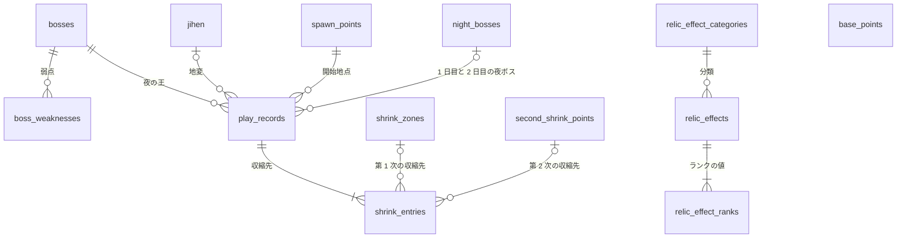

# 共通設計: データベースの共通仕様

## 1. 目的

テーブルの名前、型、変え方、初期データの入れ方を 1 か所で決める。
どのテーブルも同じ決まりで作り、マイグレーションの書き方で迷わないようにする。

## 2. 範囲

やること:

- スキーマと名前の決まり
- 型の選び方(識別子、座標、日時、文字列)
- 行の消し方
- マイグレーションの作り方と適用の時点
- マスタの初期データの持ち方と、その一覧
- テーブルの全体の関係

やらないこと:

- 機能ごとの列の意味と制約。機能ごとの仕様書に書く
- バックアップ。手元で動かす間は持たない

## 3. 画面

なし。

## 4. API

なし。

## 5. データ

### 5.1 持ち主

データベースに触れるのはバックエンドだけである。
Gateway と画面はデータベースを知らない。

データベースは 1 つ(`nightreign`)、スキーマは `game` の 1 つとする。
EF Core の既定のスキーマと、マイグレーションの履歴のテーブル(`game.__ef_migrations_history`)も `game` に置く。

### 5.2 名前

- テーブルの名前は英小文字の複数形のスネークケースにする。例: `shrink_zones`。地変は `jihen` とする。
- 列の名前はスネークケースにする。C# のプロパティ名は PascalCase にし、構成で対応を書く。
- 外部キーの列は `<参照先の単数形>_id` とする。例: `spawn_point_id`
- 制約とインデックスの名前は EF Core の既定に任せる。

### 5.3 型

| 中身 | 型 | 決まり |
|---|---|---|
| マスタの識別子(ボス、地変、遺物効果の分類) | `varchar(50)` | 英小文字とアンダースコア。例: `gladius`、`rotted_forest`。画面とテストから値で参照するので、変えない |
| そのほかの識別子 | `integer` の自動の採番(identity) | マスタは初期データで固定の値を入れる |
| 座標、半径 | `numeric(7,2)` | マップ画像の px。0 以上 1024 以下 |
| 日時 | `timestamp with time zone` | UTC で保存する |
| 名前 | `varchar(100)` | |
| 備考 | `varchar(500)` | |
| 真偽 | `boolean` | `NOT NULL` にし、既定値を持たせる |
| 決まった値の一覧 | `varchar` と検査の制約 | 例: `calc_type IN ('multiply', ...)`。PostgreSQL の enum 型を使わない。値を足すときに型の変更が要るためである |

すべてのテーブルに `created_at`(`timestamp with time zone`、`NOT NULL`、既定値は今の時刻)を持たせる。
値はデータベースの既定値で入れ、アプリから入れない。

### 5.4 行の消し方

- 記録(`play_records`、`shrink_entries`)は消さない(決定の記録 [0005](../decisions/0005-keep-play-records.md))。
- マスタは、記録から参照されていなければ実際に消す。参照されていれば消さずに 409 を返す。外部キーは `ON DELETE RESTRICT` にする。
- 記録から参照されるマスタは、夜の王、地変、開始地点、収縮候補地、第二収縮地点、夜ボスである。
- 親を消すと子が要らなくなるもの(`boss_weaknesses`、`relic_effect_ranks`、`shrink_entries`)は `ON DELETE CASCADE` にする。

### 5.5 マイグレーション

- テーブルの変更は EF Core Migrations で行う(決定の記録 [0003](../decisions/0003-ef-core-migrations.md))。`psql` で DDL を流さない。
- マイグレーションの名前は英語の PascalCase で、何を変えるかを書く。例: `AddNightBossToPlayRecord`
- `main` にあるマイグレーションを書き換えない。直すときは新しいマイグレーションを足す。
- バックエンドは起動のときに、未適用のマイグレーションを適用する。適用に失敗したら、起動を止める。
- 動かすバックエンドは 1 つだけである。複数を同時に起動すると適用が競合するので、増やすときは適用の仕方を見直す。

最初のマイグレーションは、NestJS 版の V1 から V11 の最終の形を 1 つにまとめたものとする。
V1 から V11 の SQL は、コミット `6529442` の `backend/migrations/` にある。

NestJS 版のデータベースの記録は、新しいスキーマへ移さずに捨てる(決定の記録 [0003](../decisions/0003-ef-core-migrations.md))。
旧版のデータベースが残った手元では、次の手順でボリュームを消してから起動する。

```bash
docker compose down
docker volume rm eldenring_nightreign_tools_postgres_data
docker compose up --build
```

バックエンドは起動のとき、`game.flyway_schema_history` があれば、マイグレーションを適用せずに起動を止める。
ログには、旧版のデータベースであることと、上の手順を出す。
旧版のテーブルに重ねてマイグレーションを適用し、分かりにくい誤りで止まることを防ぐためである。

### 5.6 マスタの初期データ

初期データは `Data/Seed/` のクラスに持ち、EF Core の `HasData` でマイグレーションに含める。
識別子は固定の値で書く。

| テーブル | 件数 | 移す元 | 備考 |
|---|---|---|---|
| `bosses` | 10 | V3 | |
| `boss_weaknesses` | 15 | V3 | |
| `jihen` | 5 | V3 | 中心の座標を px に直す(0 から 1 の値に 1024 を掛ける) |
| `shrink_zones` | 12 | V3、V9 | ダミーの座標である(要件定義の 12 章)。半径は 12 か所とも 256(マップの幅の半分を直径とする円)にする。実際の半径は座標と合わせて取り直す |
| `second_shrink_points` | 12 | V10 | |
| `spawn_points` | 9 | V8 | |
| `base_points` | 15 | V7 | `map_id` は `normal` |
| `night_bosses` | 35 | V10 | 1 日目 14 体、2 日目 21 体 |
| `relic_effect_categories` | 8 | V11 | |
| `relic_effects`、`relic_effect_ranks` | V11 のすべて | V11 | |

夜の王:

| 識別子 | 名前 | 弱点 | DLC |
|---|---|---|---|
| `gladius` | 三つ首の獣 | 聖 | |
| `edere` | 喰らいつく顎 | 毒 | |
| `gnostor` | 知性の蟲 | 炎 | |
| `maris` | 兆し | 雷 | |
| `libra` | 調律の魔物 | 聖、炎、発狂 | |
| `fulgor` | 闇駆ける狩人 | 雷 | |
| `caligo` | 霧の裂け目 | 炎 | |
| `nameless` | 夜を象る者 | 聖、炎、雷 | |
| `harmonia` | 英雄武器の娘たち | 睡眠 | ○ |
| `strages` | 反逆のストラゲス | 聖、炎 | ○ |

地変:

| 識別子 | 名前 | 場所 | マップ画像 |
|---|---|---|---|
| `crater` | 火口 | 北 | `jihen-kakou.webp` |
| `mountain` | 山嶺 | 北西 | `jihen-sankan.webp` |
| `rotted_forest` | 腐れ森 | 南西 | `jihen-fuhai.webp` |
| `noklateo` | 隠れ都ノクラテオ | 中央 | `jihen-nokurateou.webp` |
| `great_cavern` | 大空洞 | 全体 | なし。通常のマップを使う |

マップ画像の列は、画面側の対応表(`frontend/src/lib/mapImage.ts`)が持つ。
今の対応表は `kakou` などの別の識別子を鍵にしていて、上の識別子と合っていない。
段階 3 で、上の識別子に合わせて直す。

### 5.7 全体の関係

記録がマスタを参照し、マスタ同士はほとんど参照しないことを読み取ってほしい。



`shrink_entries` の 1 行は、第 1 次なら収縮候補地を、第 2 次なら第二収縮地点を参照する(決定の記録 [0008](../decisions/0008-second-shrink-by-point.md))。
`base_points` は、どのテーブルからも参照されない(決定の記録 [0010](../decisions/0010-night-boss-in-record.md))。

## 6. サービスの間のやり取り

なし。

## 7. 受け入れ条件

| 識別子 | 条件 |
|---|---|
| `AC-DB-01` | 空のデータベースでバックエンドを起動すると、`game` スキーマにすべてのテーブルができ、`game.__ef_migrations_history` に最初のマイグレーションが 1 行入る |
| `AC-DB-02` | 同じデータベースでバックエンドを 2 回起動しても、2 回目はマイグレーションを適用せず、起動が成功する |
| `AC-DB-03` | 起動の後に `GET /api/v1/bosses` を呼ぶと 10 件が返り、`gladius` の弱点が `holy` の 1 件である |
| `AC-DB-04` | 起動の後に `GET /api/v1/night-bosses` を呼ぶと 35 件が返り、`day` が 1 のものが 14 件である |
| `AC-DB-05` | `GET /api/v1/jihen` の `crater` の中心の座標が、0 から 1024 の px の値(512、204.8)である |
| `AC-DB-06` | 記録から参照されている収縮候補地を管理の API で消すと 409 が返り、行が残る |
| `AC-DB-07` | 記録を保存すると、`created_at` に UTC の今の時刻が入る |
| `AC-DB-08` | `game.flyway_schema_history` のあるデータベースでバックエンドを起動すると、起動が止まり、ログに旧版のデータベースであることとボリュームを消す手順が出て、テーブルが変わらない |

## 8. 未決事項

- **記録の件数が増えたときのインデックス**: パターン検索は `play_records` を `boss_id`、`spawn_point_id`、`jihen_id` で絞る。この 3 列の複合インデックスを最初のマイグレーションに入れる。効果は測っていない。
