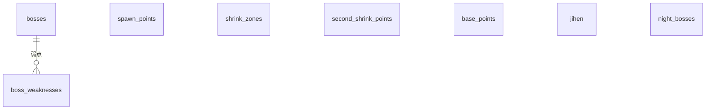
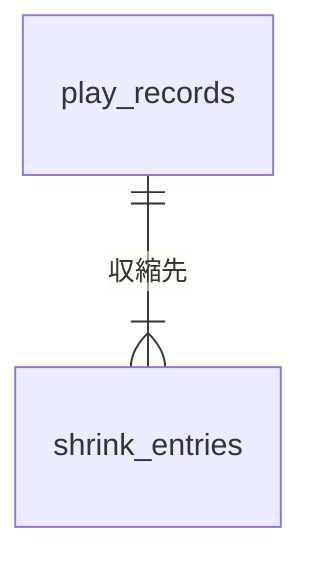
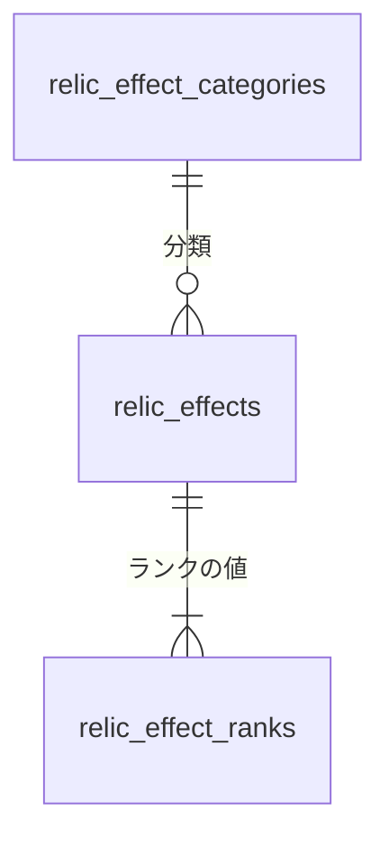

# 共通設計: データベースの共通仕様

## 1. 目的

テーブルの名前、型、変え方、初期データの入れ方を 1 か所で決める。
どのテーブルも同じ決まりで作り、マイグレーションの書き方で迷わないようにする。

## 2. 範囲

やること:

- スキーマと名前の決まり
- 型の選び方(識別子、座標、日時、文字列)
- 行の消し方
- マイグレーションの作り方と適用の時点
- マスタの初期データの持ち方と、その一覧
- テーブルの全体の関係
- テーブルの定義書の作り方

やらないこと:

- 機能ごとの列の意味と制約。機能ごとの仕様書に書く
- バックアップ。手元で動かす間は持たない

## 3. 画面

なし。

## 4. API

なし。

## 5. データ

### 5.1 持ち主

データベースに触れるのはバックエンドの 3 つのサービスだけである。
Gateway と画面はデータベースを知らない。

PostgreSQL のコンテナは 1 つとし、サービスごとにデータベースと利用者を分ける(決定の記録 [0012](../decisions/0012-split-services-by-feature.md))。
各サービスの利用者は、自分のデータベースだけを持ち、ほかのデータベースにつなげない。

| サービス | データベース | 利用者 | テーブル |
|---|---|---|---|
| `master-service` | `nightreign_master` | `nightreign_master` | `bosses`、`boss_weaknesses`、`jihen`、`spawn_points`、`shrink_zones`、`second_shrink_points`、`base_points`、`night_bosses` |
| `record-service` | `nightreign_record` | `nightreign_record` | `play_records`、`shrink_entries` |
| `relic-service` | `nightreign_relic` | `nightreign_relic` | `relic_effect_categories`、`relic_effects`、`relic_effect_ranks` |

- データベースと利用者は、`db` のコンテナが初めて起動したときに、`db/init/` の手順で作る。合言葉は環境変数で渡す(実行環境 5.2)。
- どのデータベースも、スキーマは `game` の 1 つとする。EF Core の既定のスキーマと、マイグレーションの履歴のテーブル(`game.__ef_migrations_history`)も `game` に置く。
- データベースをまたぐ外部キーは持てない。記録からマスタへの参照は、`record-service` が保存のときに `master-service` に問い合わせて確かめる。

### 5.2 名前

- テーブルの名前は英小文字の複数形のスネークケースにする。例: `shrink_zones`。地変は `jihen` とする。
- 列の名前はスネークケースにする。C# のプロパティ名は PascalCase にし、構成で対応を書く。
- 外部キーの列は `<参照先の単数形>_id` とする。例: `spawn_point_id`
- 制約とインデックスの名前は EF Core の既定に任せる。

### 5.3 型

| 中身 | 型 | 決まり |
|---|---|---|
| マスタの識別子(ボス、地変、遺物効果の分類) | `varchar(50)` | 英小文字とアンダースコア。例: `gladius`、`rotted_forest`。画面とテストから値で参照するので、変えない |
| そのほかの識別子 | `integer` の自動の採番(identity) | マスタは初期データで固定の値を入れる |
| 座標、半径 | `numeric(7,2)` | マップ画像の px。0 以上 1024 以下 |
| 日時 | `timestamp with time zone` | UTC で保存する |
| 名前 | `varchar(100)` | |
| 備考 | `varchar(500)` | |
| 真偽 | `boolean` | `NOT NULL` にし、既定値を持たせる |
| 決まった値の一覧 | `varchar` と検査の制約 | 例: `calc_type IN ('multiply', ...)`。PostgreSQL の enum 型を使わない。値を足すときに型の変更が要るためである |

すべてのテーブルに `created_at`(`timestamp with time zone`、`NOT NULL`、既定値は今の時刻)を持たせる。
値はデータベースの既定値で入れ、アプリから入れない。

### 5.4 行の消し方

- 記録(`play_records`、`shrink_entries`)は消さない(決定の記録 [0005](../decisions/0005-keep-play-records.md))。
- マスタも消さない。管理の画面で要らなくなった行は、`hidden_at` に日時を入れて非表示にする(決定の記録 [0013](../decisions/0013-hide-masters-instead-of-delete.md))。非表示にできるのは、開始地点、収縮候補地、第二収縮地点、拠点候補地である。
- 同じデータベースの中の外部キーは `ON DELETE RESTRICT` にする。ただし、親を消すと子が要らなくなるもの(`boss_weaknesses`、`relic_effect_ranks`、`shrink_entries`)は `ON DELETE CASCADE` にする。

### 5.5 マイグレーション

- テーブルの変更は EF Core Migrations で行う(決定の記録 [0003](../decisions/0003-ef-core-migrations.md))。`psql` で DDL を流さない。
- マイグレーションの名前は英語の PascalCase で、何を変えるかを書く。例: `AddNightBossToPlayRecord`
- `main` にあるマイグレーションを書き換えない。直すときは新しいマイグレーションを足す。
- マイグレーションはサービスごとに持ち、各サービスの Infrastructure の `Persistence/Migrations/` に置く。
- 各サービスは起動のときに、自分のデータベースへ未適用のマイグレーションを適用する。適用に失敗したら、起動を止める。
- 各サービスは 1 つずつ動かす。同じサービスを複数同時に起動すると適用が競合するので、増やすときは適用の仕方を見直す。
- ステージングと本番では、起動のときに適用せず、配置の前にマイグレーションの束で適用する(決定の記録 [0015](../decisions/0015-migrate-before-deploy.md))。手順と、マイグレーションの互換の規則は [CI/CD と AWS への配置](common-delivery.md) の 6.3 に書く。

各サービスの最初のマイグレーションは、NestJS 版の V1 から V11 の最終の形のうち、そのサービスの持つテーブルを 1 つにまとめたものとする。
V1 から V11 の SQL は、コミット `6529442` の `backend/migrations/` にある。

NestJS 版のデータベースの記録は、新しいスキーマへ移さずに捨てる(決定の記録 [0003](../decisions/0003-ef-core-migrations.md))。
旧版のボリュームが残った手元では、`db/init/` の手順が走らず、サービスごとのデータベースと利用者ができない。
次の手順でボリュームを消してから起動する。

```bash
docker compose down
docker volume rm eldenring_nightreign_tools_postgres_data
docker compose up --build
```

各サービスは起動のとき、自分のデータベースか利用者がないためにつなげなければ、マイグレーションを適用せずに起動を止める。
ログには、データベースと利用者は空のボリュームでだけ作られることと、上の手順を出す。
接続の誤りの文言だけでは、旧版のボリュームが残っていることに気付きにくいためである。

### 5.6 マスタの初期データ

初期データは各サービスの Infrastructure の `Persistence/Seed/` のクラスに持ち、EF Core の `HasData` でマイグレーションに含める。
識別子は固定の値で書く。
整数の識別子は 1000 以下とし、自動の採番は 1001 から始める。
初期データを決まった識別子で入れても、管理の画面から足した行の識別子とぶつからないようにするためである。

| テーブル | 件数 | 移す元 | 備考 |
|---|---|---|---|
| `bosses` | 10 | V3 | |
| `boss_weaknesses` | 15 | V3 | |
| `jihen` | 5 | V3 | 中心の座標を px に直す(0 から 1 の値に 1024 を掛ける) |
| `shrink_zones` | 12 | V10 | ダミーの座標である(要件定義の 12 章)。V3 の 12 か所(収縮地点A〜L)は格子に並べただけだったので、V10 の第二収縮地点と同じ名前と中心に置き直す。半径は 12 か所とも 255 にする。旧版のデータベースで、利用者が実際のゲームを見て登録した円の半径である |
| `second_shrink_points` | 12 | V10 | |
| `spawn_points` | 9 | V8 | |
| `base_points` | 15 | V7 | `map_id` は `normal` |
| `night_bosses` | 35 | V10 | 1 日目 14 体、2 日目 21 体 |
| `relic_effect_categories` | 8 | V11 | |
| `relic_effects`、`relic_effect_ranks` | V11 のすべて | V11 | |

夜の王と地変は、次の表の順を並び順(`sort_order`、1 から)として持つ。
画面の選択の欄に、この順で並べるためである。

夜の王:

| 識別子 | 名前 | 弱点 | DLC |
|---|---|---|---|
| `gladius` | 三つ首の獣 | 聖 | |
| `edere` | 喰らいつく顎 | 毒 | |
| `gnostor` | 知性の蟲 | 炎 | |
| `maris` | 兆し | 雷 | |
| `libra` | 調律の魔物 | 聖、炎、発狂 | |
| `fulgor` | 闇駆ける狩人 | 雷 | |
| `caligo` | 霧の裂け目 | 炎 | |
| `nameless` | 夜を象る者 | 聖、炎、雷 | |
| `harmonia` | 英雄武器の娘たち | 睡眠 | ○ |
| `strages` | 反逆のストラゲス | 聖、炎 | ○ |

地変:

| 識別子 | 名前 | 場所 | マップ画像 |
|---|---|---|---|
| `crater` | 火口 | 北 | `jihen-kakou.webp` |
| `mountain` | 山嶺 | 北西 | `jihen-sankan.webp` |
| `rotted_forest` | 腐れ森 | 南西 | `jihen-fuhai.webp` |
| `noklateo` | 隠れ都ノクラテオ | 中央 | `jihen-nokurateou.webp` |
| `great_cavern` | 大空洞 | 全体 | なし。通常のマップを使う |

マップ画像の列は、画面側の対応表(`frontend/src/lib/mapImage.ts`)が持ち、上の識別子を鍵にする。

### 5.7 全体の関係

テーブルの関係は、サービスのデータベースの中で閉じていて、記録からマスタへは識別子だけを持つことを読み取ってほしい。

`master-service`(`nightreign_master`):



`record-service`(`nightreign_record`):



`relic-service`(`nightreign_relic`):



`play_records` は、夜の王、地変、開始地点、1 日目と 2 日目の夜ボスを、`shrink_entries` は収縮候補地か第二収縮地点を、識別子で持つ。
どれも `nightreign_master` の行の識別子で、外部キーはない。
`shrink_entries` の 1 行は、第 1 次なら収縮候補地を、第 2 次なら第二収縮地点を持つ(決定の記録 [0008](../decisions/0008-second-shrink-by-point.md))。
`base_points` は、どこからも参照されない(決定の記録 [0010](../decisions/0010-night-boss-in-record.md))。

### 5.8 テーブルの定義書

テーブルの定義書は、手で書かずに、エンティティから作る(決定の記録 [0017](../decisions/0017-schema-doc-from-entities.md))。
説明の書き場所は 1 か所にし、エンティティ、データベース、定義書の 3 つで説明が食い違わないようにする。

- **説明を書く所**: Domain のエンティティの XML ドキュメントコメント(`<summary>`)に書く。クラスに書いたものがテーブルの説明に、プロパティに書いたものが列の説明になる。基底のクラスで宣言したプロパティは、基底のクラスに書く。
- **データベースに入れる**: 各サービスの Infrastructure は、モデルを組み立てるときに、この説明をテーブルと列のコメントにする。コメントの変更はマイグレーションで適用する(5.5)。Domain は EF Core を使わないままにする。
- **説明のない列を許さない**: どのテーブルとどの列にも説明を書く。説明のないものがあると、テストが落ちる。
- **定義書を作る**: 道具のプロジェクト(`backend/tools/`)が、各サービスの EF Core のモデルを読んで、`docs/database/<サービス>.md` を書き出す。データベースにはつながない。

```bash
MSYS_NO_PATHCONV=1 docker compose run --rm backend-sdk dotnet run --project tools/NightreignTools.SchemaDoc -- /src/docs/database
```

定義書には、テーブルごとに次を載せる。

| 項目 | 中身 |
|---|---|
| テーブル | スキーマ付きの名前と説明 |
| 列 | 名前、データベースの型(文字数と桁を含む。例: `character varying(100)`、`numeric(7,2)`)、NULL を許すか、既定値、説明 |
| 主キー | 列 |
| 外部キー | 列、参照先のテーブルと列、親を消したときの動き |
| 索引 | 名前、列、一意か |
| 検査の制約 | 名前と式 |

定義書は生成物なので、手で直さない。
エンティティかテーブルの設定を変えたら、同じ PR で定義書を作り直してコミットする。
CI は定義書を作り直し、コミットされたものと違えば落ちる。

## 6. サービスの間のやり取り

データベースどうしのやり取りはない。
サービスの間の呼び出しは、[サービスの共通構成](common-service.md) の 5.5 に書く。

## 7. 受け入れ条件

| 識別子 | 条件 |
|---|---|
| `AC-DB-01` | 空のデータベースで各サービスを起動すると、`game` スキーマに 5.1 の表のそのサービスのテーブルがすべてでき、`game.__ef_migrations_history` に最初のマイグレーションが 1 行入る |
| `AC-DB-02` | 同じデータベースで同じサービスを 2 回起動しても、2 回目はマイグレーションを適用せず、起動が成功する |
| `AC-DB-03` | 起動の後に `GET /api/v1/bosses` を呼ぶと 10 件が返り、`gladius` の弱点が `holy` の 1 件である |
| `AC-DB-04` | 起動の後に `GET /api/v1/night-bosses` を呼ぶと 35 件が返り、`day` が 1 のものが 14 件である |
| `AC-DB-05` | `GET /api/v1/jihen` の `crater` の中心の座標が、0 から 1024 の px の値(512、204.8)である |
| `AC-DB-06` | 収縮候補地を管理の API で非表示にすると、行が残り、`hidden_at` に日時が入る |
| `AC-DB-07` | 記録を保存すると、`created_at` に UTC の今の時刻が入る |
| `AC-DB-08` | 自分のデータベースがないサーバーにサービスをつなぐと、起動が止まり、ログに、データベースと利用者は空のボリュームでだけ作られることと、ボリュームを消す手順が出る |
| `AC-DB-09` | `nightreign_record` の利用者で `nightreign_master` につなごうとすると、拒まれる |
| `AC-DB-10` | 各サービスのモデルの、すべてのテーブルとすべての列に説明がある。説明のない列を足すと、テストが落ちる |
| `AC-DB-11` | マイグレーションを適用したデータベースで、`game.shrink_zones` の `name_ja` 列のコメントが、エンティティの `NameJa` の `<summary>` と同じである |
| `AC-DB-12` | 定義書を作ると、`docs/database/master.md` の `game.shrink_zones` の表に、`name_ja` が `character varying(100)`、NULL を許さない、説明付きで載る |
| `AC-DB-13` | 定義書を作り直さずにエンティティの説明を変えた PR では、CI の定義書の確かめが落ちる |

## 8. 未決事項

- **記録の件数が増えたときのインデックス**: パターン検索は `play_records` を `boss_id`、`spawn_point_id`、`jihen_id` で絞る。この 3 列の複合インデックスを最初のマイグレーションに入れる。効果は測っていない。
