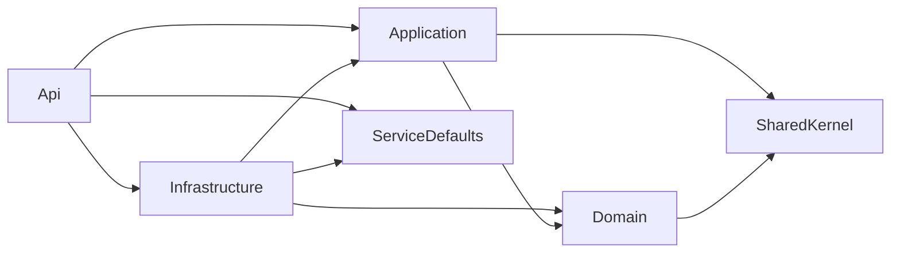

# 共通設計: サービスの共通構成

## 1. 目的

3 つのバックエンドのサービスを、同じ層の分け方、同じ名前、同じ例外の扱いで書けるようにする。
機能を足すときに、どのサービスのどの層に何を書くかで迷わないようにする。

## 2. 範囲

やること:

- サービスの分け方と、それぞれの持ち物
- サービスの中のプロジェクトと層(クリーンアーキテクチャ)
- 層ごとの責務と、頼ってよい向き
- サービスの間の呼び出し
- 例外から HTTP の応答への変換
- 設定と秘密の値の渡し方
- ログ
- テストの方針

やらないこと:

- パスとエラーの形。「API の共通仕様」に書く
- テーブルとマイグレーション。「データベースの共通仕様」に書く
- コンテナとコマンド。「実行環境」に書く

### この文書で使う言葉

| 言葉 | 意味 |
|---|---|
| サービス | 1 つのコンテナで動き、自分のデータベースを持つバックエンド。`master-service`、`record-service`、`relic-service` の 3 つ |
| エンドポイント | 1 つのメソッドとパスの組に答える入口。Minimal API の `MapGet` などで登録する |
| アプリケーションサービス | 1 つの機能の操作(保存、検索、取得)を受け持つクラス。Application の層に置く |
| ポート | Application が外へ求める働きのインターフェース。リポジトリや、ほかのサービスへの問い合わせ |
| DTO | API の入力と出力の形を表す record |
| エンティティ | 業務の規則を持つクラス。Domain の層に置き、EF Core が保存に使う |

## 3. 画面

なし。

## 4. API

なし。

## 5. データ

### 5.1 サービス

機能ごとに 3 つのサービスに分ける(決定の記録 [0012](../decisions/0012-split-services-by-feature.md))。

| サービス | ポート(コンテナの間) | 受け持つ機能 | 持つデータ | 呼ぶ相手 |
|---|---|---|---|---|
| `master-service` | 8081 | マスタの取得、マスタの管理 | 夜の王、地変、開始地点、収縮候補地、第二収縮地点、拠点候補地、夜ボス | なし |
| `record-service` | 8082 | プレイ記録、パターン検索 | 記録、収縮先 | `master-service` |
| `relic-service` | 8083 | ビルドシミュレーターの効果のマスタ | 遺物の効果の分類、効果、ランク | なし |

- どのサービスも、自分のデータベースだけに触れる。ほかのサービスのデータが要るときは、そのサービスの API を呼ぶ。
- サービスの間の呼び出しは、`record-service` から `master-service` への一方向だけにする。逆向きを足すときは、決定の記録を書く。

### 5.2 プロジェクト

各サービスを、クリーンアーキテクチャの 4 つの層のプロジェクトに分ける(決定の記録 [0011](../decisions/0011-clean-architecture.md))。

```
backend/
├── NightreignTools.slnx
├── Directory.Build.props                   # 全プロジェクトの共通の設定(net10.0、Nullable、警告を誤りに)
├── Directory.Packages.props                # パッケージの版を 1 か所で決める
├── shared/
│   ├── NightreignTools.SharedKernel/       # 業務の例外。どこにも頼らない
│   └── NightreignTools.ServiceDefaults/    # 共通の部品: エラーの形、例外の変換、サービス間キー、/health、接続文字列の検証、起動のときのマイグレーション
├── master/
│   ├── NightreignTools.Master.Domain/
│   ├── NightreignTools.Master.Application/
│   ├── NightreignTools.Master.Infrastructure/
│   ├── NightreignTools.Master.Api/
│   ├── NightreignTools.Master.Tests/
│   └── Dockerfile
├── record/                                 # master と同じ形。NightreignTools.Record.*
├── relic/                                  # master と同じ形。NightreignTools.Relic.*
└── .config/dotnet-tools.json               # dotnet-ef の版を固定する
```

名前空間は、プロジェクトの名前にディレクトリを足したものとする。
例: `NightreignTools.Record.Application.PlayRecords`

### 5.3 層と頼ってよい向き

内側(Domain)へだけ頼り、Domain と Application が EF Core と ASP.NET Core を知らないことを読み取ってほしい。



| 層 | 書くこと | 書かないこと | 頼ってよいもの |
|---|---|---|---|
| Domain | エンティティと値オブジェクト、業務の規則(例: 日と段階の組が重複しない、座標が 0 以上 1024 以下) | 保存、HTTP、DTO | SharedKernel |
| Application | アプリケーションサービス、ポート(`I<対象>Repository`、`IMasterDirectory`)、DTO、エンティティと DTO の詰め替え、存在の確認 | EF Core、HTTP の型(`IResult`、`HttpContext`)、`HttpClient` | Domain、SharedKernel |
| Infrastructure | DbContext、構成、マイグレーション、初期データ、リポジトリの実装、ほかのサービスを呼ぶクライアント | 業務の規則 | Application、Domain、EF Core、ServiceDefaults の永続化の部品 |
| Api | `Program.cs`(登録の組み立て)、エンドポイント、状態の決定(200、201、204) | 業務の規則、EF Core の直接の利用 | Application、Infrastructure、ServiceDefaults |

決まりは次のとおりとする。

- 業務の規則はエンティティに書き、エンティティを作るときと変えるときに確かめる。規則に反したら `BusinessRuleException` を投げる。
- アプリケーションサービスはインターフェースと実装に分け、各層の `DependencyInjection.cs` の `Add<層>` で登録する。`Program.cs` は `AddServiceDefaults`、`AddValidation`、`AddApplication`、`AddInfrastructure` を呼ぶだけにする。
- `AddValidation` は ServiceDefaults ではなく、各サービスの `Program.cs` で呼ぶ。検証の情報はソースジェネレーターがこの呼び出しに差し込むので、エンドポイントを持つ Api のプロジェクトで呼ばないと、検証が働かない。入力の検証の誤りは、ServiceDefaults が ProblemDetails から 4.3 の形に書き替える。
- エンティティを API の応答に返さない。DTO に詰め替える。
- すべての非同期のメソッドは `CancellationToken` を受け取り、下の層へ渡す。
- 読み取りだけのクエリには `AsNoTracking()` を付ける。
- `Nullable` を有効にし、警告を誤りとして扱う(`TreatWarningsAsErrors`)。

### 5.4 エンドポイントの登録

```csharp
// Api/Program.cs の一部
builder.AddServiceDefaults();             // エラーの形、例外の変換、サービス間キー、/health
builder.Services.AddValidation();         // DTO の注釈による入力の検証
builder.Services.AddApplication();
builder.Services.AddInfrastructure();     // DbContext と、起動のときのマイグレーション

var app = builder.Build();
app.UseServiceDefaults();
var api = app.MapGroup("/api/v1");
api.MapSpawnPointEndpoints();
```

- 機能ごとに `Map<機能>Endpoints` の拡張メソッドを 1 つ作る。
- サービス間キーの検証は、ServiceDefaults のミドルウェアで 1 回だけ行う。`/health` を除くすべてのパスで、ルートを探す前に確かめる。エンドポイントごとに付けると付け忘れが起き、ルートの後で確かめると、キーのない要求に 404 と 401 のどちらを返すかで、どのパスがあるかを知られるためである。
- サービスの間だけで使う API は `/internal/v1` の下に置く。Gateway はこのパスを振り分けない。
- Gateway は今のとおり、ルーティングを `Program.cs` と `appsettings.json` に集める。

### 5.5 サービスの間の呼び出し

`record-service` は、Application のポート `IMasterDirectory` を通して `master-service` を呼ぶ。
実装は Infrastructure の `HttpClient` のクライアントに置く。

| 項目 | 決まり |
|---|---|
| 呼び先 | 環境変数 `MASTER_SERVICE_URL`(compose では `http://master-service:8081`) |
| 認証 | Gateway と同じ `X-Service-Key` を付ける |
| 期限 | 1 回の試行につき 3 秒、全体で 10 秒 |
| 再試行 | 通信の失敗と 5xx のときに 2 回まで。`Microsoft.Extensions.Http.Resilience` の標準の設定を使う |
| 応答しないとき | `ServiceUnavailableException` を投げ、応答は 503 とする |

使う内部の API は [マスタの管理](master-admin.md) の 4.4 に書く。

### 5.6 例外と HTTP の応答

アプリケーションサービスとエンティティは、SharedKernel の次の例外を投げる。
ServiceDefaults の共通の例外ハンドラ(`IExceptionHandler`)が、これを「API の共通仕様」4.3 の形に変える。

| 例外 | 状態 | 使う時 |
|---|---|---|
| `NotFoundException` | 404 | 識別子の行がない |
| `BusinessRuleException` | 400 | 業務の規則に反する。例: 日と段階の組が重複する |
| `ConflictException` | 409 | 今の状態と食い違う操作。今のところ使う所はない |
| `ServiceUnavailableException` | 503 | 呼んだサービスが応答しない |
| 入力の検証の失敗 | 400 | DTO の注釈に反する。.NET 10 の Minimal API の検証(`AddValidation`)が出す |
| それ以外の例外 | 500 | 想定していない誤り。ログに全体を出し、応答には固定の文言だけを返す |

例外の文言を見て状態を決めない。
例外の型で決める。

### 5.7 設定と秘密の値

| 名前 | 使う所 | 渡し方 |
|---|---|---|
| `ConnectionStrings__Default` | 各サービス | 環境変数。compose がサービスごとのデータベースの名前と利用者から組み立てる |
| `SERVICE_KEY` | Gateway、各サービス | 環境変数 |
| `MASTER_SERVICE_URL` | Gateway、`record-service` | 環境変数。`RECORD_SERVICE_URL`、`RELIC_SERVICE_URL` は Gateway だけが使い、それぞれのサービスを作る段階で足す |
| `ADMIN_KEY` | Gateway | 環境変数。16 文字以上 |
| `CORS_ORIGINS` | Gateway | 環境変数。既定は `http://localhost:3000` |

- 秘密の値を `appsettings.json` に書かない。
- 必要な値がないときは、起動の時点で例外を投げて止める。動いてから失敗させない。
- 起動できなかったときは、理由をログに 1 回だけ出し、終了コード 1 で終わる。

### 5.8 ログ

- ASP.NET Core の `ILogger` で出す。
- 500 の誤りは、例外の全体を `Error` で出す。
- 400、404、409 は `Information`、503 は `Warning` で出す。
- 備考の本文と秘密の値をログに出さない。

### 5.9 テスト

サービスごとに 1 つのテストのプロジェクト(`NightreignTools.<サービス>.Tests`)を持つ。
共通の部品(`shared/`)の単体のテストは、`shared/NightreignTools.Shared.Tests` に置く。

| 種類 | 対象 | 置き場 | 決まり |
|---|---|---|---|
| 単体 | エンティティ、アプリケーションサービス | `Unit/` | データベースも HTTP も使わない。ポートは手書きの偽物に差し替える |
| 結合 | リポジトリの実装、エンドポイント | `Integration/` | `WebApplicationFactory` で起動し、テスト用のデータベースにつなぐ。EF Core の InMemory を使わない。PostgreSQL と動きが違うためである |
| 層 | プロジェクトの参照 | `Architecture/` | Domain と Application のアセンブリが、EF Core と ASP.NET Core を参照していないことを確かめる |

- テストの名前かコメントに、受け入れ条件の識別子を書く。
- テスト用のデータベースは `nightreign_<サービス>_test` とし、接続文字列を環境変数 `ConnectionStrings__Test` で渡す。テストの始めにデータベースを消し、起動のときのマイグレーションで作り直す。
- `record-service` の結合のテストでは、`IMasterDirectory` を偽物に差し替え、`master-service` を起動しない。`master-service` の内部の API の形は、`master-service` のテストで確かめる。
- テストは 1 つのデータベースを共有するので、並べて走らせない。

## 6. サービスの間のやり取り

- Gateway から各サービスへの呼び出しは「API の共通仕様」4.6 と 6 章に書く。
- `record-service` から `master-service` への呼び出しは 5.5 に書く。

## 7. 受け入れ条件

| 識別子 | 条件 |
|---|---|
| `AC-SVC-01` | `SERVICE_KEY` を渡さずにサービスを起動すると、起動が失敗し、ログに `SERVICE_KEY` の名前が出る |
| `AC-SVC-02` | 接続文字列を渡さずにサービスを起動すると、起動が失敗する |
| `AC-SVC-03` | アプリケーションサービスが `NotFoundException` を投げると、応答が 404 になる |
| `AC-SVC-04` | アプリケーションサービスが `BusinessRuleException` を投げると、応答が 400 になる |
| `AC-SVC-05` | アプリケーションサービスが `ConflictException` を投げると、応答が 409 になる |
| `AC-SVC-06` | 各サービスの Domain と Application のアセンブリが、`Microsoft.EntityFrameworkCore` と `Microsoft.AspNetCore` で始まるアセンブリを参照していない |
| `AC-SVC-07` | 各サービスの `/api/v1` と `/internal/v1` の下のすべてのパスが、サービス間キーなしで 401 を返す |
| `AC-SVC-08` | `dotnet build` が、Nullable の警告なしで通る |
| `AC-SVC-09` | `ServiceUnavailableException` を投げると、応答が 503 になる |
| `AC-SVC-10` | `MASTER_SERVICE_URL` を渡さずに `record-service` を起動すると、起動が失敗し、ログに `MASTER_SERVICE_URL` の名前が出る |

## 8. 未決事項

- **Gateway のテスト**: Gateway にテストのプロジェクトがない。キーの付け直し(`AC-API-05`)と振り分けを、Gateway のテストで確かめるか、compose で動かして確かめるか。段階 0 で決める。
- **マスタの問い合わせの写し**: パターン検索のたびに `master-service` へ問い合わせる。重くなったら、`record-service` に短い間だけ写しを持たせるか、マスタの変更を知らせる仕組みを考える。今は測っていない。
