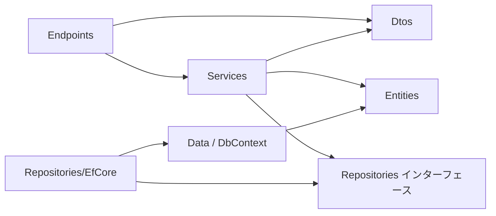

# 共通設計: サービスの共通構成

## 1. 目的

.NET のバックエンドと Gateway を、同じ層の分け方、同じ名前、同じ例外の扱いで書けるようにする。
機能を足すときに、どこに何を書くかで迷わないようにする。

## 2. 範囲

やること:

- バックエンドのプロジェクトとディレクトリの分け方
- 層ごとの責務と、頼ってよい向き
- 例外から HTTP の応答への変換
- 設定と秘密の値の渡し方
- ログ
- テストの方針

やらないこと:

- パスとエラーの形。「API の共通仕様」に書く
- テーブルとマイグレーション。「データベースの共通仕様」に書く
- コンテナとコマンド。「実行環境」に書く

### この文書で使う言葉

| 言葉 | 意味 |
|---|---|
| エンドポイント | 1 つのメソッドとパスの組に答える入口。Minimal API の `MapGet` などで登録する |
| サービス | 業務の規則(存在の確認、重複の確認、集計)を持つクラス |
| リポジトリ | データの出し入れを受け持つクラス。サービスに EF Core を見せないためにある |
| DTO | API の入力と出力の形を表す record |
| エンティティ | テーブルの 1 行を表すクラス。EF Core が扱う |

## 3. 画面

なし。

## 4. API

なし。

## 5. データ

### 5.1 プロジェクト

```
backend/
├── NightreignTools.Backend/          # ASP.NET Core 10 の Web プロジェクト
│   ├── Program.cs                    # サービスの登録とエンドポイントの登録だけを書く
│   ├── Endpoints/                    # <機能>Endpoints.cs。MapGroup で束ねる
│   ├── Dtos/<機能>/                  # 入力と出力の record
│   ├── Services/                     # I<機能>Service と、その実装
│   ├── Repositories/                 # I<対象>Repository
│   │   └── EfCore/                   # EF Core による実装
│   ├── Entities/                     # エンティティ
│   ├── Data/
│   │   ├── NightreignDbContext.cs
│   │   ├── Configurations/           # IEntityTypeConfiguration<T>
│   │   ├── Seed/                     # マスタの初期データ
│   │   └── Migrations/               # EF Core が作る
│   └── Common/                       # 例外、例外の変換、サービス間キーの検証、時刻
├── NightreignTools.Backend.Tests/    # xUnit
├── Dockerfile
└── .config/dotnet-tools.json         # dotnet-ef の版を固定する
```

プロジェクトを層ごとに分けない。
テーブルが 13、エンドポイントが 30 程度の規模で、層ごとのプロジェクトの参照を管理する手間に見合わないためである。
層の間の向きは、ディレクトリと名前空間で守る。

名前空間は `NightreignTools.Backend.<ディレクトリ>` とする。
Gateway の名前空間は今のまま `Gateway` とする。

### 5.2 層と頼ってよい向き

エンドポイントからリポジトリへ一方向に頼り、逆向きの参照がないことを読み取ってほしい。



| 層 | 書くこと | 書かないこと |
|---|---|---|
| エンドポイント | パスとメソッド、DTO の受け取り、サービスの呼び出し、状態の決定(200、201、204) | 業務の規則、EF Core |
| サービス | 存在の確認、重複の確認、集計、エンティティと DTO の詰め替え | HTTP の型(`IResult`、`HttpContext`)、EF Core |
| リポジトリ | クエリ、保存 | 業務の規則 |
| エンティティ | 列に当たるプロパティと関連 | 注釈による列の設定。構成のクラスに書く |

決まりは次のとおりとする。

- サービスとリポジトリは、インターフェースと実装に分け、`Program.cs` で `AddScoped` に登録する。サービスの単体テストで、リポジトリを偽物に差し替えるためである。
- エンティティを API の応答に返さない。DTO に詰め替える。テーブルを変えたときに API の形が変わらないようにするためである。
- すべての非同期のメソッドは `CancellationToken` を受け取り、下の層へ渡す。
- 読み取りだけのクエリには `AsNoTracking()` を付ける。
- `Nullable` を有効にし、警告を誤りとして扱う(`TreatWarningsAsErrors`)。

### 5.3 エンドポイントの登録

```csharp
// Program.cs の一部
var api = app.MapGroup("/api/v1")
    .AddEndpointFilter<ServiceKeyFilter>();
api.MapMasterEndpoints();
api.MapPatternEndpoints();
api.MapPlayRecordEndpoints();
api.MapGroup("/admin").MapAdminEndpoints();
```

- 機能ごとに `Map<機能>Endpoints` の拡張メソッドを 1 つ作る。
- サービス間キーの検証は、`/api/v1` のグループに 1 回だけ付ける。エンドポイントごとに付けない。付け忘れを防ぐためである。
- Gateway は今のとおり、ルーティングを `Program.cs` に集める。Gateway のエンドポイントは 2 つしかないためである。

### 5.4 例外と HTTP の応答

サービスは次の例外を投げる。
共通の例外ハンドラ(`IExceptionHandler`)が、これを「API の共通仕様」4.3 の形に変える。

| 例外 | 状態 | 使う時 |
|---|---|---|
| `NotFoundException` | 404 | 識別子の行がない |
| `BusinessRuleException` | 400 | 業務の規則に反する。例: 日と段階の組が重複する |
| `ConflictException` | 409 | 記録から参照されているマスタを消そうとした |
| 入力の検証の失敗 | 400 | DTO の注釈に反する。.NET 10 の Minimal API の検証(`AddValidation`)が出す |
| それ以外の例外 | 500 | 想定していない誤り。ログに全体を出し、応答には固定の文言だけを返す |

例外の文言を見て状態を決めない。
例外の型で決める。

### 5.5 設定と秘密の値

| 名前 | 使う所 | 渡し方 |
|---|---|---|
| `ConnectionStrings__Default` | バックエンド | 環境変数。compose が `DB_USER` と `DB_PASSWORD` から組み立てる |
| `SERVICE_KEY` | Gateway、バックエンド | 環境変数 |
| `JWT_SECRET` | Gateway | 環境変数 |
| `ADMIN_KEY` | Gateway | 環境変数。16 文字以上 |
| `CORS_ORIGINS` | Gateway | 環境変数。既定は `http://localhost:3000` |

- 秘密の値を `appsettings.json` に書かない。
- 必要な値がないときは、起動の時点で例外を投げて止める。動いてから失敗させない。

### 5.6 ログ

- ASP.NET Core の `ILogger` で出す。
- 500 の誤りは、例外の全体を `Error` で出す。
- 400、404、409 は `Information` で出す。
- 備考の本文と秘密の値をログに出さない。

### 5.7 テスト

| 種類 | 対象 | 置き場 | 決まり |
|---|---|---|---|
| 単体 | サービス | `Tests/Services/` | リポジトリを手書きの偽物に差し替える。データベースを使わない |
| リポジトリ | リポジトリの実装 | `Tests/Repositories/` | テスト用のデータベースに対して走らせる。EF Core の InMemory を使わない。PostgreSQL と動きが違うためである |
| API | エンドポイント | `Tests/Endpoints/` | `WebApplicationFactory` で起動し、テスト用のデータベースにつなぐ |

- テストの名前かコメントに、受け入れ条件の識別子を書く。
- テスト用のデータベースは `nightreign_test` とし、テストの始めにマイグレーションを適用する。

## 6. サービスの間のやり取り

Gateway からバックエンドへの呼び出しだけがある。
決まりは「API の共通仕様」4.6 と 6 章に書く。

## 7. 受け入れ条件

| 識別子 | 条件 |
|---|---|
| `AC-SVC-01` | `SERVICE_KEY` を渡さずにバックエンドを起動すると、起動が失敗し、ログに `SERVICE_KEY` の名前が出る |
| `AC-SVC-02` | 接続文字列を渡さずにバックエンドを起動すると、起動が失敗する |
| `AC-SVC-03` | サービスが `NotFoundException` を投げると、応答が 404 になる |
| `AC-SVC-04` | サービスが `BusinessRuleException` を投げると、応答が 400 になる |
| `AC-SVC-05` | サービスが `ConflictException` を投げると、応答が 409 になる |
| `AC-SVC-06` | `Services/` のファイルに `Microsoft.EntityFrameworkCore` の `using` がない |
| `AC-SVC-07` | `/api/v1` の下のすべてのエンドポイントが、サービス間キーなしで 401 を返す(エンドポイントの一覧を列挙して確かめるテスト) |
| `AC-SVC-08` | `dotnet build` が、Nullable の警告なしで通る |

## 8. 未決事項

- **層の検査の道具**: `AC-SVC-06` を、テストの中の文字列の検索で確かめるか、NetArchTest のような道具を入れるか。段階 0 で決める。
- **Gateway のテスト**: Gateway にテストのプロジェクトがない。キーの付け直し(`AC-API-05`)を、Gateway のテストで確かめるか、compose で動かして確かめるか。段階 0 で決める。
