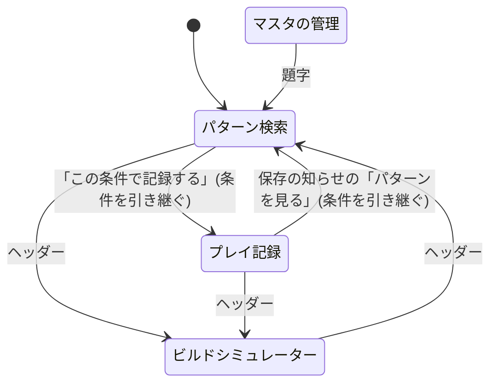

# 画面設計: 画面の一覧と遷移

## 1. 目的

画面の一覧、パス、画面の間の移り方、各画面の骨組みを決める。
個々の項目と操作は、機能ごとの仕様書に書く。

## 2. 範囲

やること:

- 画面の一覧とパス
- 画面の間の移り方
- 各画面の骨組み(どこに何の区画を置くか)
- 見つからないページ

やらないこと:

- 色、書体、部品。「画面の共通仕様」に書く
- 見た目の試作。[画面一覧](../screens/index.md) に置く

## 3. 画面

### 3.1 一覧

| パス | 画面 | 使う人 | 試作 |
|---|---|---|---|
| `/` | パターン検索 | プレイヤー | [試作](../screens/pattern.md) |
| `/record` | プレイ記録 | プレイヤー | [試作](../screens/record.md) |
| `/build` | ビルドシミュレーター | プレイヤー | [試作](../screens/build.md) |
| `/admin` | マスタの管理 | 管理者 | [試作](../screens/admin.md) |

上のどれでもないパスには、見つからないページを出す。
見つからないページには「この場所は霧に包まれています」と、パターン検索への入口を出す。

### 3.2 URL に残すもの

| 画面 | クエリ | 内容 |
|---|---|---|
| `/` | `boss`、`spawn`、`jihen` | 選んだ条件。再読み込みと共有で条件を保つ |
| `/record` | `boss`、`spawn`、`jihen` | パターン検索から移ったときの初期の条件 |

クエリの値がマスタにないときは、その条件だけを選んでいない状態にする。
エラーにしない。

### 3.3 遷移

画面の間の移り方を読み取ってほしい。
ヘッダーからは、管理の画面を除くどの画面へも移れる。

- 保存の後に、自動で別の画面へ移らない。今の画面は保存の 3 秒後に `/` へ移るが、続けて記録したいときに邪魔になるためである。
- 入力中の記録があるときにプレイ記録の画面を離れても、確かめの枠を出さない。入力中の内容は端末に残るためである([プレイ記録](play-record.md))。

### 3.4 パターン検索の骨組み

| 区画 | 広い画面 | 狭い画面 |
|---|---|---|
| 条件 | 左のパネルの上 | ボトムシートの上 |
| パターンの一覧 | 左のパネルの下 | ボトムシートの下 |
| マップ | 右 | 上。幅いっぱい |

### 3.5 プレイ記録の骨組み

| 区画 | 広い画面 | 狭い画面 |
|---|---|---|
| 収縮先のスロット、夜ボス、残り時間 | 左のパネルの上 | ボトムシートの上。畳んだ状態では、入力中のスロットだけを出す |
| 今回の条件、備考、保存 | 左のパネルの下 | ボトムシートの下 |
| マップ | 右 | 上。幅いっぱい |

### 3.6 ビルドシミュレーターの骨組み

| 区画 | 広い画面 | 狭い画面 |
|---|---|---|
| 通常効果 | 左の列 | 1 番目 |
| 深層効果 | 中の列 | 2 番目 |
| 効果の合計 | 右の列 | 3 番目 |

### 3.7 マスタの管理の骨組み

| 区画 | 広い画面 | 狭い画面 |
|---|---|---|
| 管理用の鍵の入力 | 鍵がないときは、画面の中央にこれだけを出す | 同じ |
| 登録するものとマップの種類 | 左のパネルの上 | ボトムシートの上 |
| 入力の欄 | 左のパネルの中 | ボトムシートの中 |
| 登録済みの一覧 | 左のパネルの下 | ボトムシートの下 |
| マップ | 右 | 上 |

## 4. API

なし。

## 5. データ

なし。

## 6. サービスの間のやり取り

なし。

## 7. 受け入れ条件

| 識別子 | 条件 |
|---|---|
| `AC-NAV-01` | `/?boss=gladius&spawn=1` を開くと、三つ首の獣と 1 番の開始地点が選ばれた状態で、パターンが出る |
| `AC-NAV-02` | `/?boss=unknown` を開くと、夜の王を選んでいない状態で画面が出て、エラーにならない |
| `AC-NAV-03` | パターン検索で条件を選んで「この条件で記録する」を押すと、`/record` に同じ条件が選ばれた状態で移る |
| `AC-NAV-04` | `/no-such-page` を開くと、見つからないページが出て、パターン検索への入口がある |
| `AC-NAV-05` | ヘッダーに `/admin` への入口がない |
| `AC-NAV-06` | 記録を保存して 5 秒待っても、プレイ記録の画面に留まる |

## 8. 未決事項

なし。
